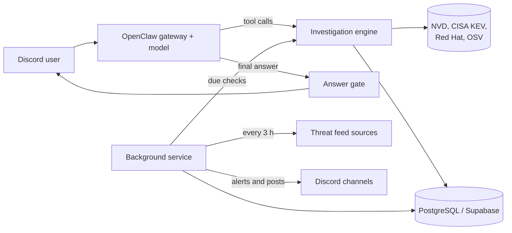

# ThreatIntel AI

An evidence-first threat intelligence plugin for [OpenClaw](https://github.com/openclaw/openclaw). It gives a Discord bot three capabilities for a SOC:

- **CVE investigation.** Retrieves NVD, CISA KEV, Red Hat, and OSV evidence, compares the sources, and returns facts that each trace back to retrieved evidence.
- **CVE watchlist.** Re-investigates chosen CVEs on a schedule and alerts a Discord channel when their intelligence actually changes.
- **Threat feed.** Every 3 hours, collects advisories from CISA and major vendors, prioritises them for a Bio/Pharma SOC, and posts only what is worth hunting.

The model is the reasoning layer, never the source of truth. Every fact comes from a retrieved source, a deterministic check compares the model's answer with that evidence before it is sent, and nothing is invented: no MITRE ATT&CK mappings, detection claims, or indicators that a source did not publish.

**Version 0.6.** Pinned to OpenClaw 2026.7.1-2.

## Contents

- [How it works](#how-it-works)
- [Tools](#tools)
- [Getting started](#getting-started)
- [Configuration](#configuration)
- [CVE investigation](#cve-investigation)
- [Answer checking](#answer-checking)
- [Watchlist](#watchlist)
- [Threat feed](#threat-feed)
- [Deployment](#deployment)
- [Testing and CI](#testing-and-ci)
- [Project layout](#project-layout)
- [Design rules](#design-rules)

## How it works



- The **gateway** runs the model and this plugin's tools. Investigations are saved to PostgreSQL with hashed evidence, and reused while fresh.
- The **answer gate** compares each final answer with that session's evidence and asks for a revision, or adds a visible warning, when they disagree.
- One **background service** runs watchlist checks, threat feed cycles, and delivery of both. Its schedule, locks, and outbox live in PostgreSQL, so a restart or reboot resumes where it stopped.

## Tools

| Tool | Who | Purpose |
|---|---|---|
| `threatintel_investigate` | Everyone | Investigate a CVE, reusing a fresh saved investigation or querying the sources. |
| `threatintel_prior_investigation` | Everyone | Retrieve the latest saved investigation of a CVE. |
| `threatintel_compare_investigations` | Everyone | Compare the two most recent investigations of a CVE. |
| `threatintel_watch_add` | Owner | Watch a CVE. Records a baseline immediately. |
| `threatintel_watch_remove` | Owner | Stop watching. Past alerts are kept. |
| `threatintel_watch_list` | Owner | Watched CVEs with their last result, last error, and next check. |
| `threatintel_watch_set` | Owner | Change a CVE's interval (6 to 168 hours) or pause it. |
| `threatintel_watch_status` | Owner | Delivery counts, recent alerts with message IDs; can re-queue failed alerts. |
| `threatintel_feed_status` | Owner | Last and next feed cycle, per-run counts, source outcomes, recent posts. |
| `threatintel_feed_run_now` | Owner | Make the next feed cycle due immediately. |

"Owner" means a sender listed in OpenClaw's `commands.ownerAllowFrom`. The flag comes from OpenClaw, never from the model's arguments, so a prompt cannot grant itself access. Everyone else gets `owner_only`, including for the read-only tools.

## Getting started

### Prerequisites

- Node.js 24.15 or later
- OpenClaw 2026.7.1-2, with a Discord channel configured
- PostgreSQL 17, or a Supabase project

### 1. Build

```bash
npm ci
npm run build
npm run validate
```

### 2. Database

For a new database, apply `db/schema.sql`, then every file in `db/migrations/` in order. For an existing one, including Supabase, apply only the migrations you have not run yet, with the Supabase SQL editor or `psql`.

| Migration | Adds | Required from |
|---|---|---|
| `001_evidence_integrity.sql` | Evidence hashes, replay support | v0.3. Without it, investigations are not saved. |
| `002_watchlist.sql` | `watchlist`, `watch_events` | v0.5, to use the watchlist |
| `003_threat_feed.sql` | Feed tables; a `channel` column on `watch_events` | v0.6. Without it, watch alerts fail as well as the feed. |

Each migration runs in one transaction and enables row-level security with no policies, which blocks Supabase's `anon` and `authenticated` Data API roles while the table owner the plugin connects as keeps access.

The plugin connects with these environment variables. On a systemd host, put them in `~/.openclaw/.env`, which the gateway loads.

| Variable | Notes |
|---|---|
| `THREATINTEL_DB_HOST`, `THREATINTEL_DB_PORT`, `THREATINTEL_DB_NAME`, `THREATINTEL_DB_USER`, `THREATINTEL_DB_PASSWORD` | Required |
| `THREATINTEL_DB_SSL` | Remote connections use TLS by default without verifying the certificate. `verify-full` verifies it; `disable` turns TLS off. |
| `THREATINTEL_DB_SSL_CA` | Path to your provider's CA file, for `verify-full` |

### 3. Install into OpenClaw

```bash
openclaw plugins install --link .
openclaw plugins enable threatintel-ai-engine

# The answer gate reads the model's final answer, which needs conversation access.
openclaw config set plugins.entries.threatintel-ai-engine.hooks.allowConversationAccess true

# Owner-only tools refuse everyone until an owner is set.
openclaw config set commands.ownerAllowFrom '["discord:<your-discord-user-id>"]'

openclaw gateway restart
openclaw plugins inspect threatintel-ai-engine --runtime --json
```

### 4. Turn on the watchlist and feed (optional)

```bash
C=plugins.entries.threatintel-ai-engine.config
openclaw config set $C.watchEnabled true
openclaw config set $C.watchNotifyTarget "channel:<alerts-channel-id>"
openclaw config set $C.feedEnabled true
openclaw config set $C.feedNotifyTarget "channel:<feed-channel-id>"
openclaw gateway restart
```

## Configuration

All settings live under `plugins.entries.threatintel-ai-engine.config`. Lists are JSON arrays, for example `openclaw config set $C.feedSecurityProducts '["FortiGate","CrowdStrike Falcon"]'`. Restart the gateway after a change.

### General

| Field | Default | Meaning |
|---|---|---|
| `nvdApiKey` | none | NVD API key, for higher rate limits. |
| `requestTimeoutMs` | `15000` | Per-request timeout for sources (1,000 to 60,000). |

### Watchlist

| Field | Default | Meaning |
|---|---|---|
| `watchEnabled` | `false` | Run scheduled checks and alert delivery. |
| `watchNotifyTarget` | none | Alert channel, for example `channel:<id>`. Without it, changes are recorded but not sent. |
| `watchTickMinutes` | `5` | How often the service looks for due checks and pending messages (1 to 60). |
| `watchDefaultIntervalHours` | `24` | Default time between checks of one CVE (6 to 168). |
| `watchMaxEntries` | `100` | Most CVEs the watchlist may hold (1 to 500). |
| `watchDeliveryMode` | `direct` | `direct` or `openclaw_queue`; see [Delivery](#delivery-and-retries). Also used by the feed. |

### Threat feed

| Field | Default | Meaning |
|---|---|---|
| `feedEnabled` | `false` | Run the feed. |
| `feedNotifyTarget` | none | Feed channel, for example `channel:<id>`. |
| `feedIntervalHours` | `3` | Hours between cycles (1 to 24). |
| `feedSources` | all | Enabled [source ids](#sources-1). |
| `feedBioPharmaTerms` | built-in industry terms | Replaces the built-in terms when set. |
| `feedBioPharmaProducts` | empty | LIMS, laboratory, manufacturing, and OT products in your Bio/Pharma environments. |
| `feedSecurityProducts` | empty | Security products in scope: EDR, SIEM, firewall, VPN, IAM, PAM, email security. |
| `feedLogSources` | empty | Log sources and platforms in scope, for example `Microsoft 365`, `Entra ID`, `AWS`. |
| `feedMinPriority` | `P3` | Lowest priority posted. |
| `feedMaxPostsPerCycle` | `3` | Posts per cycle (1 to 20). |
| `feedCooldownHours` | `24` | Wait before posting an update to a posted item. |
| `feedDedupeDays` | `14` | How long a posted CVE suppresses other advisories about it. |
| `feedMaxAgeDays` | `3` | Older items are not posted for the first time; waiting items expire. |
| `feedUrgentBypass` | `true` | Let new P1 items with confirmed exploitation exceed the per-cycle limit. |
| `feedUrgentMaxPerCycle` | `2` | Most urgent posts above the limit. |

## CVE investigation

### Sources

| Source | Provides | If it has no record |
|---|---|---|
| NVD | CVSS, CWE, affected products, references | `not-found` or `partial` |
| CISA KEV | Known exploitation | `not-listed`, which does not establish that exploitation has not occurred |
| Red Hat | Vendor impact and shipped fixes | No vendor assessment |
| OSV | Ecosystem package names and fixed versions | Normal for closed-source products |

Every response is validated against a strict contract before it is used. Failures are reported as explicit limitations, and `observed_absence` (checked, not found) is never confused with an error. Transient failures (timeouts, 429, 5xx) are retried within a time budget that honours `Retry-After`; a 404 is never retried.

OSV's `CVE-*` records hold only upstream git ranges, so the engine follows up to two aliased GHSA advisories and reports any it did not use. Unreviewed and withdrawn advisories are not treated as fix evidence.

Investigations are saved with SHA-256-hashed evidence and reused while fresh. If only OSV fails, the investigation stays `confirmed` and is reused for one hour with the gap shown; NVD, CISA KEV, and Red Hat failures prevent reuse.

### Source correlation

`summary.correlations` compares what independent sources say, keeping every source's value:

| Classification | Meaning | Example |
|---|---|---|
| `agreement` | Sources say the same thing | CISA KEV and NVD record the same KEV date |
| `conflict` | Sources disagree about the same thing | Different scores for identical CVSS metrics |
| `explained_difference` | Sources answer different questions | NVD 10.0 and Red Hat 9.8, because they rate `S` differently |
| `incomplete` | A comparison could not be completed | The KEV check failed; a package could not be matched confidently |

Comparisons are deliberately narrow. CVSS v3 and v4 are never compared. Red Hat products are matched to NVD by CPE product and major version. Fixed versions are compared only when a package's name and namespace match one NVD vendor's product, because `log4j` and `log4j-core` are different artifacts. Red Hat's rating scale is never reported as agreeing with CVSS severity; treating "Important" as similar to HIGH is labelled as an approximation.

Each assessment statement cites the facts, provider checks, or evidence it rests on, and inferences reference their supporting facts.

### Changes over time

A refreshed investigation includes `changesSincePrior`, and `threatintel_compare_investigations` compares the two latest saved ones. The baseline is first re-derived from its stored evidence through the current engine, so each difference has one meaning:

- `intelligence_change`: a source that answered both times now says something else.
- `collection_difference`: a source was unavailable or not checked in one of them.
- `processing_difference`: the stored evidence gives a different result under the current engine.

Integrity is reported in two parts, because hashes cover evidence payloads only: `evidenceRows` (`verified`, `tampered`, `missing`, `inconsistent`, `not_hashed`, `none`) and `recordConsistency`. `fullyVerified` is true only when both hold. Comparison never writes to stored investigations.

To check offline that a saved investigation still matches its evidence:

```bash
npm run replay -- <investigation-id>
```

### Tool output

Tool results stay under 16,000 characters, OpenClaw's lowest default cap, so truncation cannot remove sections. They are compact JSON; raw payloads stay in PostgreSQL, and capped lists report `total` and `omitted`. If abnormal data would exceed the limit, the result is shortened and marked `_reducedToFit`.

## Answer checking

Before a final answer is sent, a deterministic gate compares it with the investigations from that session:

- CVE IDs, CVSS scores, severity, KEV state, and version numbers.
- Statements about a named Red Hat product, such as "OpenShift 4.12 is fixed", against that product's own rows. A family name whose products differ, such as "OpenShift", is reported as ambiguous. Negated forms ("No RHEL versions are affected", "isn't affected") are read as not-affected claims; a negation that cannot be resolved skips the sentence.
- Claims that data was just retrieved when no source was queried, that sources agree when the comparisons do not show it, or about all Red Hat products when the status counts contradict them.

A mismatch triggers one revision pass. If the delivered message still conflicts with the evidence, it is sent with a visible warning listing the conflict. Sentences that reject a claim ("the claimed 9.8 is incorrect") are skipped. Only full product names and a short list of brand words (OpenShift, JBoss, Ansible, and similar) count as naming a product.

The gate is a floor against fabrication, not a check that the reasoning is correct: it does not judge explanations, CWE names, or narrative.

## Watchlist

### What triggers an alert

Each check is compared with the CVE's baseline using the same comparison as `threatintel_compare_investigations`. Only an `intelligence_change` in these fields alerts:

- KEV listing added or removed. A move to or from `unknown` does not alert.
- CVSS score or vector.
- NVD affected versions.
- New package fixed versions.
- A Red Hat product moving to `affected` or `fixed`, or from `affected` to `not_affected`.

Nothing alerts, and the baseline does not move, when NVD or CISA KEV could not be checked (the check is retried with backoff), or when a difference is only a `collection_difference` or `processing_difference`. A baseline that fails its integrity check produces an `integrity_warning` alert instead of a silent re-baseline. After three failed checks in a row, one `monitor_failure` alert is sent, and one `monitor_recovered` alert follows.

### Delivery and retries

Alerts and feed posts are saved in the `watch_events` outbox before they are sent, so a crash never loses one. Each alert is stored once per comparison, so a retried check never repeats it, but a change that reverses and later recurs alerts each time.

- **`direct`** (default): PostgreSQL is the only retry owner. Sends use OpenClaw's `deliverOutboundPayloads` with `skipQueue: true`, so OpenClaw keeps no copy of its own. A failed send is retried with backoff for up to six attempts, then marked `failed`; the status tools can re-queue it.
- **`openclaw_queue`** (fallback): once OpenClaw has queued a message, it is marked `handed_off` and the outbox never sends it again. One message is never owned by two retry systems.

Delivery is at least once. If the gateway stops after Discord accepts a message but before the result is saved, it is sent again after restart with a note that it may repeat.

### Scheduling and recovery

Due checks and pending messages live in PostgreSQL. After a restart or reboot, overdue checks run on the first cycle, about 30 seconds after the service starts. Checks and deliveries are claimed with expiring database leases (15 minutes and 2 minutes), which work through Supabase's connection pooler, so two gateways never run the same check or send the same message. Monitoring makes at most ten checks per cycle with longer source retries than interactive use, and downloads the KEV catalog at most once an hour.

## Threat feed

Every `feedIntervalHours`, the feed collects new advisories, rates each one against your scope, and posts only the ones worth hunting. A cycle with nothing worth posting posts nothing.

### Sources

| Id | Source | Notes |
|---|---|---|
| `cisa-kev` | CISA Known Exploited Vulnerabilities | Recent additions. The only source of `confirmed` exploitation. |
| `cisa-advisories` | CISA advisories | Joint advisories' indicator sections are extracted. |
| `cisa-ics` | CISA ICS advisories | Deployment sectors are kept. |
| `msrc` | Microsoft Security Update Guide | First publications only. |
| `paloalto`, `fortinet`, `cisco` | Vendor PSIRT feeds | |
| `aws`, `gcp` | Cloud security bulletins | |

All sources are public. Each is fetched on its own with retries, so one failing source never blocks the others. A cycle where every source fails is recorded as failed, never as an empty success, and a page that answers 200 but is not a feed, such as a bot check, counts as a failure.

### Priority

Fixed rules decide priority, and every item records why. A model never decides what is posted.

| Priority | When |
|---|---|
| P1 | Bio/Pharma relevance with exploitation or high/critical severity; or CISA-confirmed exploitation of an in-scope product, log source, or manufacturing OT system |
| P2 | An in-scope security product with exploitation or high/critical severity; Bio/Pharma relevance at lower severity; reported exploitation of manufacturing OT |
| P3 | An in-scope log source or platform with exploitation or high/critical severity; or CISA-confirmed exploitation of anything else |
| ignore | Everything else |

- **Bio/Pharma relevance** needs an industry term (pharmaceutical, biotech, LIMS, clinical trial, GxP, and similar) or a configured Bio/Pharma product. "Healthcare" alone never qualifies, nor does CISA listing Healthcare among an ICS product's sectors.
- **Exploitation:** `confirmed` means CISA KEV lists the CVE; `reported` means the source itself says so. Denials win ("not known to be actively exploited"), and "an attacker could exploit" is capability, not an attack. A bulletin bundling more than 10 third-party CVEs is not confirmed exploitation of its product because one of them is in KEV.
- With the product and log-source lists empty, only Bio/Pharma items, exploited manufacturing OT, and CISA-confirmed exploitation are posted.

### Indicators

Indicators come only from a source's own "Indicators of Compromise" section, exactly as published (including defanging such as `hxxp` and `[.]`), and are posted in code spans so Discord does not link them. Domains are taken only when defanged. Without an indicator section, the post says `No IOCs published in the source.` Vendor advisories rarely publish indicators; research articles with indicator parsers are planned.

### Flood control

- One advisory has one key across feeds, so CISA's two feeds never post it twice.
- A CVE posted within `feedDedupeDays` is not posted again through another advisory unless the new one adds exploitation evidence or indicators, or covers CVEs not yet posted.
- A posted item is reposted, marked `(updated)`, only after a material change (exploitation rose, or new indicators), and only after `feedCooldownHours`, except newly confirmed P1 exploitation.
- At most `feedMaxPostsPerCycle` posts per cycle, P1 first. The rest wait for later cycles until they are older than `feedMaxAgeDays`.

### Post format

Each post is its own message, starting with a divider so consecutive posts stay apart in Discord:

```
━━━━━━━━━━━━━━━━━━━━━━━━━━━━
**Threat Name:**
Siemens Desigo, Gridscale: CVE-2026-111497

**Affected Tools / Products:**
Siemens Desigo, Gridscale

**Affected Platforms:**
Not specified in the source.

**Article:**
<https://www.cisa.gov/news-events/ics-advisories/icsa-26-316-02>

**IOCs to Hunt:**
No IOCs published in the source.
```

## Deployment

### Always-on host

The gateway needs an always-on Linux host. [deploy/gcp](deploy/gcp/README.md) runs it on a free-tier Google Cloud e2-micro, with scripts to set up the VM, migrate OpenClaw's state from another machine, and install a systemd user service that restarts after crashes and starts at boot. It also includes an optional hard spending cap, which disables billing when a budget is reached.

### Deploying a new version

On the host, after CI passes on `main`:

```bash
cd ~/ThreatIntel-AI
git pull --ff-only
npm ci
npm run build
openclaw gateway restart
```

Apply any new database migration before restarting. The bot is offline for about a minute while the gateway restarts.

### Production checklist

- **One gateway per bot token.** Two would answer every chat message twice. Leases make the background work safe, but chat is not.
- **Pinned OpenClaw.** Upgrade only after `npm test` passes on the new version: its delivery contract test checks the behaviour the outbox relies on.
- **Backups.** Check which backups your Supabase plan includes, and take a regular `pg_dump` of `investigations`, `evidence`, `facts`, `inferences`, `watchlist`, `watch_events`, `feed_items`, `feed_runs`, and `feed_state`. After a restore, replay a recent investigation.
- **Monitoring.** `monitor_failure` alerts and the status tools report source and delivery problems; nothing inside the gateway can report the gateway itself being down, so add an external uptime check.
- **Clock.** Keep NTP on. Schedules and leases use the database clock.

## Testing and CI

```bash
npm test               # build, then every suite that needs no network or database
npm run test:database  # needs PostgreSQL with the schema and all migrations
npm run test:live      # calls the live NVD, CISA, Red Hat, and OSV APIs
```

- `npm test` includes the plugin contract test, which runs the real plugin entry offline, and an OpenClaw delivery contract test that fails if OpenClaw is not the pinned version or stops honouring `skipQueue`.
- Feed tests parse recorded copies of every real feed in `test-fixtures/feed/`.
- The regression case is `CVE-2024-3094`: `confirmed` status, CVSS 10 CRITICAL, KEV `not-listed`.

GitHub Actions runs `npm test`, plugin validation, and `npm run test:database` against a real PostgreSQL 17 service on every push and pull request.

## Project layout

```
src/
  index.ts           Plugin entry: tools, config schema, hooks, background service
  engine.ts          Investigation orchestration
  sources/           NVD, CISA KEV, Red Hat, OSV clients and retry handling
  correlation/       Source correlation and assessment
  verification/      Answer gate and claim checks
  persistence/       PostgreSQL storage, history, comparison, replay
  watch/             Watchlist, shared background service, outbox delivery
  feed/              Threat feed: sources, classification, IOCs, selection
db/                  Schema and migrations
deploy/gcp/          Google Cloud deployment and spending cap
test-fixtures/feed/  Recorded feed samples for tests
```

## Design rules

- The LLM is the reasoning layer, not the source of truth.
- Every confirmed fact traces back to a retrieved evidence document, and every inference references the facts that support it.
- Source failures are explicit limitations, never silently dropped, and absence is never confused with an error.
- Deterministic rules, not the model, decide what is alerted and posted.
- Every message is saved before it is sent, and has exactly one retry owner.
